# Smart Health Intelligence Platform

# Architecture Design

## 1. Overview

本ドキュメントは、`Python-Smart-Health-Intelligence-Platform` のシステムアーキテクチャ、責務分離、データフロー、永続化、AI/ML連携、認証、マルチユーザー設計に関する基本方針を定義する。

本システムは、ユーザーの健康データを継続的に蓄積し、Feature Engineering、Analysis、Recommendation、AI、MLを段階的に組み合わせる健康管理プラットフォームである。ルールベースおよびAI/MLを利用して健康改善提案やレシピ生成を行うWebアプリケーションを目指す。

基本的な処理フロー：

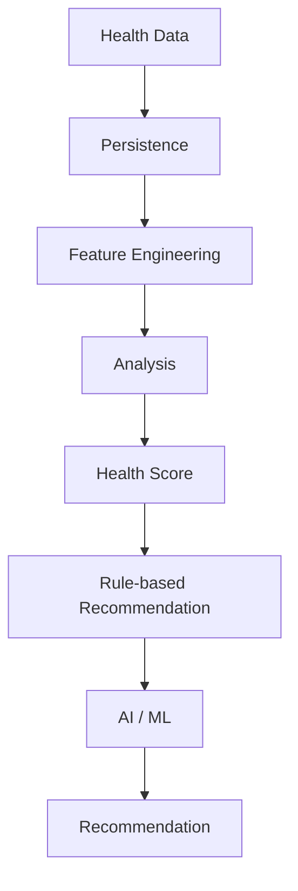

---

## 2. System Goals

本システムの主な目的は以下とする。

* 健康データを継続的に記録できる
* 食事・運動・睡眠・体重などを統合的に管理できる
* 記録データから特徴量を生成できる
* 健康状態を分析・スコアリングできる
* ルールベースで改善提案を生成できる
* Gemini等のAIを利用してレシピを生成できる
* 将来的にMLによる予測・推薦を導入できる
* 複数ユーザーが安全に利用できる
* PostgreSQLを利用してデータを永続化できる
* Streamlit Community Cloud上で公開可能な構成とする
* テスト・Lint・型チェックを自動化する

---

## 3. Technology Stack

### 3.1 Application

* Python 3.13+
* Streamlit
* Pydantic

### 3.2 Database

* PostgreSQL
* SQLAlchemy
* Alembic
* psycopg3

PostgreSQLのホスティングサービスはPhase 2で決定する。

候補：Neon / Supabase / Render / その他の無料または低コストPostgreSQLサービス

### 3.3 AI

* Google Gemini API
* `google-genai`
* Pydantic Structured Output

### 3.4 ML

* LightGBM
* MLflow
* pandas
* scikit-learn 等

MLライブラリの最終構成はPhase 8で決定する。

### 3.5 Development

* uv
* Ruff
* mypy
* pytest / pytest-cov
* GitHub Actions

---

## 4. Architecture Principles

以下を基本設計方針とする。

1. DomainとInfrastructureを分離する
2. Service層にユースケースおよびアプリケーションレベルのビジネスロジックを集約する
3. Repository Patternによって永続化処理を抽象化する
4. 外部サービスへの依存をInterface / Protocolによって抽象化する
5. ユーザー所有データを`user_id`によって分離する
6. Session Stateを永続データの保存場所として利用しない
7. Rule-based RecommendationをBaselineとして維持する
8. MLはRule-based Baselineとの比較によって採用判断する
9. MLを採用する場合でもRule-basedをFallbackとして保持する
10. PostgreSQLの具体的なクラウドサービスにアプリケーション層を直接依存させない
11. 複数Repositoryにまたがる更新処理はUnit of Workによって1トランザクションとして管理する
12. Domain ModelとDatabase ORM Modelを分離する
13. Database固有の情報をDomain Modelへ漏洩させない
14. ML Pipelineはまず1領域で確立し、その後必要に応じて他領域へ横展開する

---

## 5. High-Level Architecture

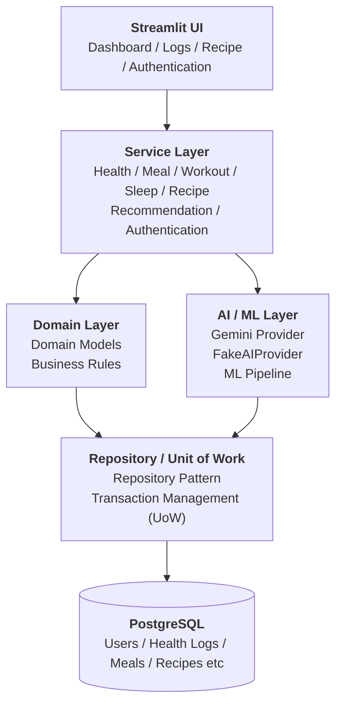

Domain LayerとAI/ML Layerはいずれも永続化が必要な場合、Repository / Unit of Workを経由してPostgreSQLへアクセスする。AI/ML Layer自体はDomain Modelを利用してデータをやり取りし、SQLAlchemyやPostgreSQLへ直接依存しない。

---

## 6. Layer Responsibilities

### 6.1 Presentation Layer

対象：

```text
app/
├── streamlit_app.py
├── pages/
└── components/
```

責務：ユーザーインターフェース、ユーザー入力の受付、Service呼び出し、結果の表示、Streamlit Session State管理。

基本的な依存関係：

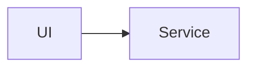

`UI → Repository` のような直接依存は原則として避ける。

### 6.2 Service Layer

想定Service：

```text
services/
├── user_service.py
├── health_service.py
├── meal_service.py
├── workout_service.py
├── sleep_service.py
├── weight_service.py
├── learning_service.py
├── goal_service.py
├── task_service.py
├── daily_journal_service.py    # DailyPlanItem / DailyTaskLogの操作も含む
├── recommendation_service.py
└── recipe_service.py
```

責務：Domain Modelの操作、Repositoryの呼び出し、複数Repositoryを跨ぐ処理、Transaction境界の調整、Recommendation処理、AI Providerの呼び出し、Feature / Analysisの実行。

`GoalService`/`TaskService`/`DailyJournalService`はGoal/Task/DailyPlanItem/DailyTaskLog/DailyJournal(Daily Journal機能。requirements.md 4.4節・4.5節参照)を扱う。このデータはHealth Score/MLの入力にはしないため、Feature Engineering/Analysis層とは接続しない。

Serviceは具体的なPostgreSQL実装へ直接依存しない。

### 6.3 Domain Layer

対象：`src/health_intelligence/domain/`

主なDomain Model：

```text
User / HealthLog / MealLog / WorkoutLog / SleepLog
WeightLog / LearningLog / Ingredient / Recipe / RecipeIngredient
Goal / Task / DailyPlanItem / DailyTaskLog / DailyJournal
```

データベース固有の仕様やStreamlit固有の処理を持たせない。

`Locale`(UI表示言語、`domain/enums.py`)は`User.locale`として永続化するEnumで、i18n(6.6節)が参照する。

### 6.4 Pydanticとdataclassの使い分け

**dataclass** — Domain Model、Feature、Analysis Result、Recommendation Result、内部処理用データ構造。Domainを外部ライブラリから独立させ、内部モデルと外部入力を分離するため。

**Pydantic** — API Input/Output、AI Structured Output、RecipeInput、Configuration、外部入力Validation、AI Response Validation。

基本境界：

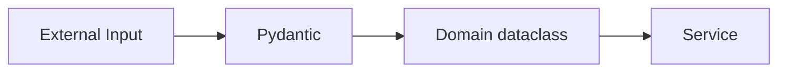

### 6.5 Repository Layer

対象：

```text
repositories/
├── user_repository.py
├── user_credential_repository.py
├── health_log_repository.py
├── meal_log_repository.py
├── workout_log_repository.py
├── sleep_log_repository.py
├── weight_log_repository.py
├── learning_log_repository.py
├── ingredient_repository.py
├── recipe_repository.py
├── recipe_ingredient_repository.py
├── goal_repository.py
├── task_repository.py
├── daily_plan_item_repository.py
├── daily_task_log_repository.py
└── daily_journal_repository.py
```

責務：CRUD、Query、Persistence、Database Exceptionの適切な変換、Unit of Workが提供するSessionの利用。

Repositoryはビジネスルールを持たない。「条件付きでMealLogを取得する」はRepositoryの責務、「Proteinが不足しているので改善提案を生成する」はService / Analysis / Recommendationの責務。

### 6.6 i18n (多言語対応)

対象：`app/i18n.py`

翻訳キーには日本語原文をそのまま使う(意味付きキーは導入しない)。`t(text, **kwargs)`が現在の表示言語に応じて`TRANSLATIONS`辞書を引き、無ければ原文をそのままフォールバック返却する。表示言語(`Locale`)は`User.locale`にDB永続化し、ログイン時にSession State(`AuthSessionState`)へコピーする。切り替えUIは`app/auth_guard.py`のサイドバーに置く。

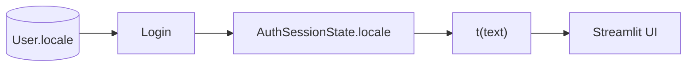

---

## 7. Database Architecture

### 7.1 Database / ORM / Migration

* PostgreSQL(特定クラウドサービスに直接依存しない。候補: Neon / Supabase 等。Phase 2で比較・決定)
* SQLAlchemyを利用。Domain ModelとORM Modelは分離する
* MigrationはAlembicを利用し、GitでMigrationファイルを管理する

### 7.2 Cloud Architecture

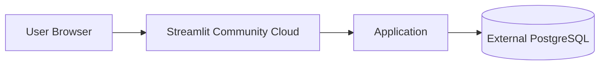

永続データはStreamlit Community Cloudのローカルファイルシステムではなく、外部PostgreSQLへ保存する。

### 7.3 Database Connection / Environment Configuration

Database接続情報は環境変数またはStreamlit Secretsから取得する(ローカル: `.env`、本番: Streamlit Secrets)。`DATABASE_URL` をソースコードへ直接記述しない。

秘密情報(`DATABASE_URL`、`GEMINI_API_KEY` 等)はGit Repositoryへコミットしない。

---

## 8. user_id Architecture

### 8.1 基本方針

ユーザー所有データ(`HealthLog` / `MealLog` / `WorkoutLog` / `SleepLog` / `WeightLog` / `LearningLog` / `Recipe` / `Goal` / `Task` / `DailyPlanItem` / `DailyTaskLog` / `DailyJournal`)には原則として`user_id`を必須とする。

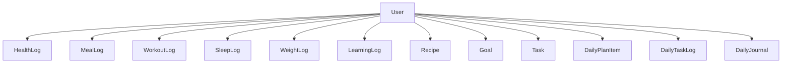

### 8.2 共通データ

`Ingredient` 等のシステム共通データは原則として`user_id`を持たない。

### 8.3 Repository Boundary

`get_meal_logs(user_id)` のようにユーザーコンテキストを明示し、ユーザーAからユーザーBのデータへアクセスできない構造を基本とする。

### 8.4 user_id Exception Rules

内部処理・バッチ処理などユーザーコンテキストを必要としない処理では`user_id`を使用しない場合があるが、その場合はSystem Contextとして明示する。ユーザー所有データを処理するBatchでは、原則として対象ユーザーを明示する。**「user_idがない場合は全ユーザーを対象とする」という暗黙的な仕様は採用しない。**

---

## 9. Session State Architecture

主な状態：`authenticated` / `user_id` / `locale`(表示言語。ログイン時に`User.locale`から復元。6.6節参照。必要に応じてUI状態等を保持)。Session Stateを永続データ保存場所として利用しない。

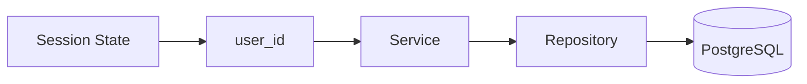

### 9.1 Session Lifecycle

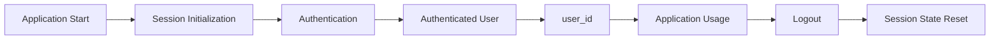

Logout時には、認証情報およびユーザー固有のSession Stateを適切にリセットする。

---

## 10. AI Architecture

AIサービスはProvider Patternによって抽象化する。

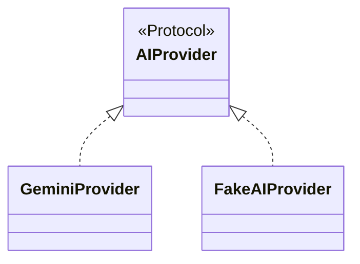

Service Layerは具体的なGemini APIに直接依存しない。

### 10.1 FakeAIProvider

API Key不要のテスト、APIコスト削減、API障害時のテスト、Deterministicなテスト、CIでのAI処理テストを目的とする。

### 10.2 AI Error Handling

Timeout / 429 Rate Limit / 503 Service Unavailable / Validation Error / その他API Errorを想定。429・503はRetry対象とし、指数バックオフを利用する。Timeoutを設定し無期限に待機しない。Validation ErrorはSchema Validationで検出する。

#### 10.2.1 Retry / Timeout方針(数値)

| 項目 | 値 |
| --- | --- |
| 最大試行回数 | 3回(初回+リトライ2回) |
| バックオフ基準秒数 | 1秒 |
| バックオフ倍率 | 2倍(指数) |
| Jitter | ±20% |
| 1回あたりのTimeout | 20秒 |
| 最悪ケース総待ち時間 | 約63秒(3回×20秒 + 1秒 + 2秒) |
| Retry対象 | 429 Rate Limit、503 Service Unavailableのみ |
| Retry対象外(即座に失敗) | Timeout、Validation Error、その他の4xxエラー |

`ai/retry_policy.py` の `RetryPolicy` / `DEFAULT_RETRY_POLICY` として定数化済み。GeminiProvider(Phase 4B)はこれを用いてRetryループを実装する。最悪ケースの待ち時間が長いため、Streamlit UI側(Phase 6)では生成中である旨とおおよその所要時間をユーザーに提示する。

---

## 11. Recommendation & ML Architecture

### 11.1 Recommendation Architecture

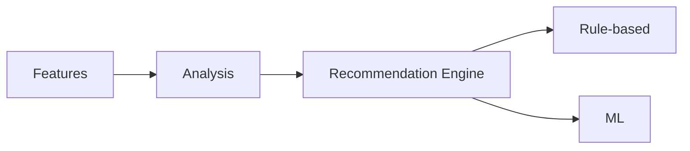

Rule-based Recommendationは初期Recommendation Engineとして実装し、同時にML評価時のBaseline、MLが利用できない場合のFallbackとしても利用する。

> `RecommendationService`は実装済みでDIコンテナ(`app/services.py`)にも登録されているが、現在のStreamlit UIのどのページからも呼び出されていない(週間グラフ中心のDashboardへ再設計した際にUI表示を外した)。UIへ再統合する場合は別途設計する。

### 11.2 ML Architecture

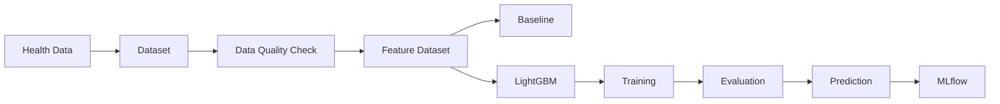

### 11.3 ML Pipeline Development Strategy

全領域(Nutrition / Weight / Sleep / Workout)を同時に完成させるのではなく、まず1領域でPipeline全体を確立する。

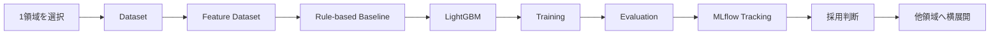

対象領域はPhase 8開始時点で、データ量・欠損率・Featureの品質・目的変数の定義可能性・予測可能性・Rule-based Baselineの性能・ML導入によるメリットを評価して決定する。

### 11.4 MLflow

Parameters / Metrics / Model / Experiment / Evaluation Resultsを記録し、実験の再現性・モデル比較・Baseline比較・採用判断に利用する。

### 11.5 ML Recommendation Strategy

* **ML採用**: MLがRule-based Baselineを十分に上回る場合
* **ML限定採用**: 領域ごとにMLの採否を判断(例: Nutrition→ML、Sleep→Rule)。すべての領域でMLを採用する必要はない
* **ML見送り**: MLがBaselineを上回らない場合はRule-basedを継続利用。ML Pipeline自体は構築・評価するが、製品Recommendationへの統合は見送ることができる

#### 11.5.1 判断基準(数値)

Nutrition/Weight/Sleep/Workoutの各領域ごとに、以下の基準で独立して判定する(詳細はrequirements.md 9.3.1)。

| 項目 | 基準 |
| --- | --- |
| 評価指標 | 回帰: MAE、分類: F1スコア(目的変数の型はPhase 8で確定) |
| 改善率閾値 | Baseline比で相対10%以上の改善 |
| 過学習チェック | train/validation誤差の差が相対20%以内 |
| 最低データ量 | 60日分以上のログ、欠損率30%未満 |
| 評価方法 | forward-chaining(時系列考慮)K分割交差検証 |

データ量・欠損率の基準を満たさない領域は、評価を待たずに見送り(Rule-based継続)とする。

### 11.6 ML Fallback

MLを製品Recommendationへ統合する場合でも、Rule-based RecommendationをFallbackとして保持する。

Fallback条件：MLモデルが利用できない / ML推論エラー / 性能が基準未達 / データ不足 / モデル更新中 / 特定領域ではML非採用。

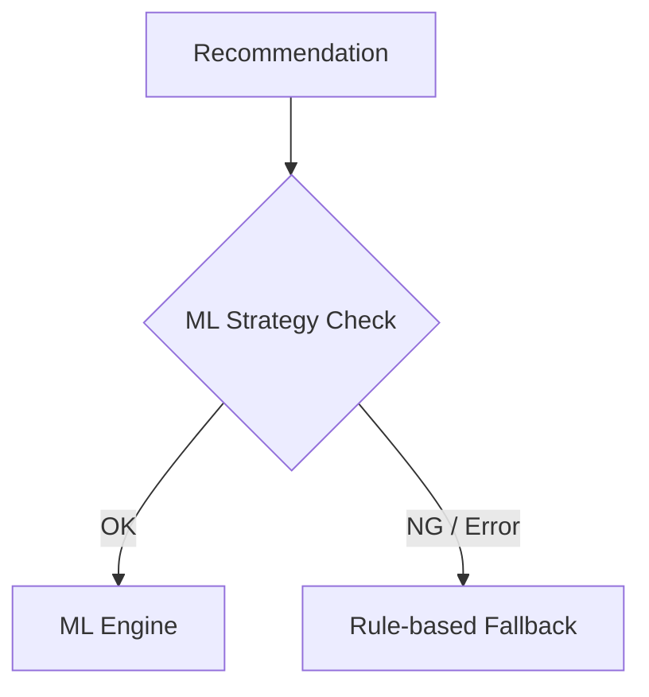

---

## 12. Feature Engineering / Analysis / Health Score

### 12.1 Feature Engineering

```text
features/
├── daily_features.py
├── weekly_features.py
├── nutrition_features.py
├── weight_features.py
├── sleep_features.py
└── workout_features.py
```

可能な限り副作用を持たない純粋な処理として実装し、Unit TestおよびML Dataset生成で再利用可能とする。

### 12.2 Analysis

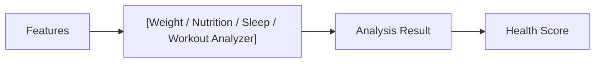

Analyzerは可能な限り決定論的に実装する。

### 12.3 Health Score

Nutrition/Weight/Sleep/Workout各Scoreを統合してHealth Scoreとする。医療診断を目的とせず、本システム独自の健康管理支援指標として扱う。

---

## 13. Recipe Architecture

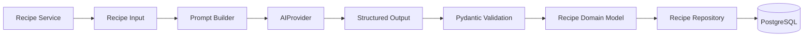

生成済みRecipeはCacheを利用し、不要なAI API呼び出しを抑制する。Recipe作成時など複数Repositoryにまたがる更新では、Unit of Workによって1つのトランザクションとして扱う。

---

## 14. Domain / ORM Separation & Mapping

Domain ModelとDatabase ORM Modelは同一モデルを必須とせず分離する。

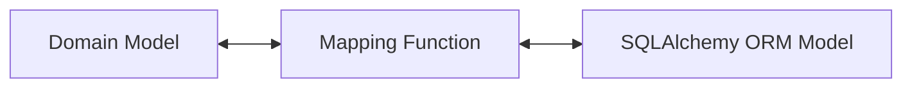

`Mapped` / `mapped_column` / `ForeignKey` / Index / Database Constraint / Relationship / Cascade / Database-specific type / Persistence metadataはORM側の責務とし、Domain側では直接扱わない。

初期実装では明示的な変換関数(`to_domain` / `to_orm`)による単純なMappingを基本とする。共通Mapperインターフェースの導入は、実装時の重複量と可読性を確認したうえで判断する。**過度な抽象化は初期段階では避ける。**

---

## 15. Unit of Work / Transaction Architecture

複数Repositoryにまたがる更新処理では、1つのSQLAlchemy Sessionを共有し、1つのトランザクションとして扱う。

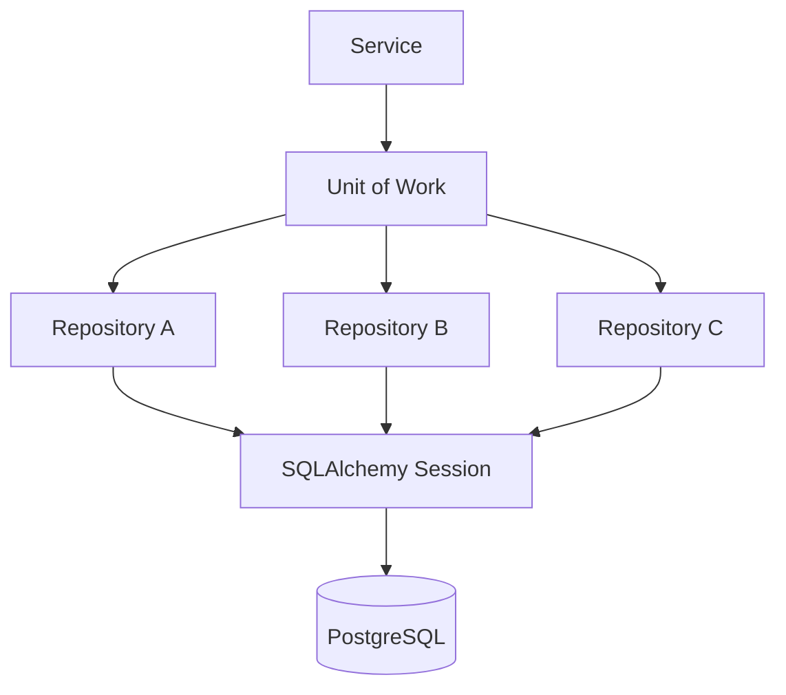

基本フロー：`Service → UoW begin → Repository operations → 成功時commit / 失敗時rollback`

Repositoryは原則として独自にSessionを生成・commit・rollbackしない。Transactionの基本的な責務はService / Unit of Work側に置く。

例：Recipe作成時、RecipeRepositoryとRecipeIngredientRepositoryは単一Sessionを共有し、片方の保存に失敗した場合は全体をRollbackすることで部分的更新を防止する。

具体的なUnit of Work実装方式、Sessionライフサイクル、RepositoryへのSession注入方式はPhase 2で確定する。

---

## 16. Dependency Direction

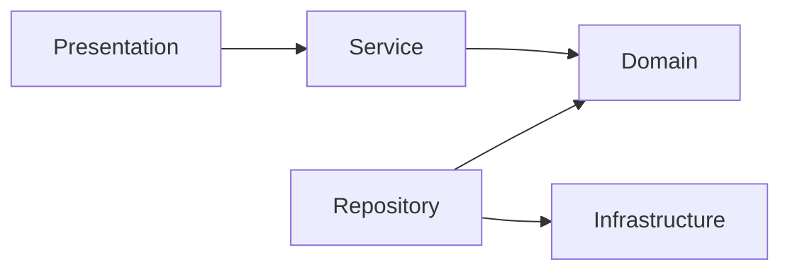

より具体的には、`Service → Repository Interface ← Repository Implementation → SQLAlchemy → PostgreSQL`。ServiceからRepositoryの抽象へ依存し、具体的なDatabase実装への依存を分離する。

---

## 17. External Service Dependencies

PostgreSQL Provider / Gemini API / Streamlit Community Cloud / MLflow。これらの具体的な実装・接続情報をDomainへ持ち込まない。

---

## 18. Testing Architecture

```text
Domain      → Unit Test
Service     → Unit Test
Repository  → Repository Test
AI Provider → FakeAIProvider Test
Database    → Integration Test
Application → E2E Test
```

重要なテスト対象：user_id分離、Repository境界、Transaction境界、Unit of Work、Rollback、AI Retry/Timeout/Validation、ML / Rule-based切り替え、Fallback、Authentication、Session State。

---

## 19. Configuration & Logging

環境固有設定(`DATABASE_URL`、`GEMINI_API_KEY` 等)をコードへハードコードせず、環境変数等から取得する。

Application全体で適切なLoggingおよびException Handlingを実装する。対象：Database Error / Transaction Error / Validation Error / Authentication Error / AI API Error / Timeout / Rate Limit / ML Prediction Error。内部エラー情報とユーザー向けエラーメッセージは適切に分離する。

---

## 20. ディレクトリ構成

```text
Python-Smart-Health-Intelligence-Platform/
├── .github/
│   └── workflows/
│       └── ci.yml
│
├── src/
│   └── health_intelligence/
│       ├── __init__.py
│       ├── domain/
│       │   ├── __init__.py
│       │   ├── models/
│       │   │   ├── __init__.py
│       │   │   ├── user.py
│       │   │   ├── health_log.py
│       │   │   ├── meal_log.py
│       │   │   ├── workout_log.py
│       │   │   ├── sleep_log.py
│       │   │   ├── weight_log.py
│       │   │   ├── learning_log.py
│       │   │   ├── ingredient.py
│       │   │   ├── recipe.py
│       │   │   ├── recipe_ingredient.py
│       │   │   ├── goal.py
│       │   │   ├── task.py
│       │   │   ├── daily_plan_item.py
│       │   │   ├── daily_task_log.py
│       │   │   └── daily_journal.py
│       │   └── enums.py
│       ├── services/
│       │   ├── __init__.py
│       │   ├── user_service.py
│       │   ├── health_service.py
│       │   ├── meal_service.py
│       │   ├── workout_service.py
│       │   ├── sleep_service.py
│       │   ├── weight_service.py
│       │   ├── learning_service.py
│       │   ├── goal_service.py
│       │   ├── task_service.py
│       │   ├── daily_journal_service.py
│       │   ├── recommendation_service.py
│       │   └── recipe_service.py
│       ├── repositories/
│       │   ├── __init__.py
│       │   ├── protocols.py          # Repository Interface(Protocol)
│       │   ├── unit_of_work.py       # Unit of Work Interface(Protocol)
│       │   └── sqlalchemy/           # 具体的な実装
│       │       ├── user_repository.py
│       │       ├── user_credential_repository.py
│       │       ├── health_log_repository.py
│       │       ├── meal_log_repository.py
│       │       ├── workout_log_repository.py
│       │       ├── sleep_log_repository.py
│       │       ├── weight_log_repository.py
│       │       ├── learning_log_repository.py
│       │       ├── ingredient_repository.py
│       │       ├── recipe_repository.py
│       │       ├── recipe_ingredient_repository.py
│       │       ├── goal_repository.py
│       │       ├── task_repository.py
│       │       ├── daily_plan_item_repository.py
│       │       ├── daily_task_log_repository.py
│       │       ├── daily_journal_repository.py
│       │       ├── factory.py
│       │       └── unit_of_work.py
│       ├── database/
│       │   ├── connection.py
│       │   ├── schema.py
│       │   └── migrations/
│       ├── features/
│       ├── analysis/
│       ├── recommendation/
│       ├── recipe/
│       ├── ai/
│       ├── auth/
│       ├── ml/
│       └── config.py
│
├── app/
│   ├── streamlit_app.py       # st.navigation()によるルーター
│   ├── auth_guard.py          # 認証ガード・言語切り替えUI
│   ├── i18n.py                # 6.6節
│   ├── services.py            # DIコンテナ(Service/Repository/UoWの組み立て)
│   ├── pages/                 # login / dashboard / today / goals / csv_import / recipe
│   └── components/
│
├── tests/
├── data/
├── docs/
│   ├── architecture.md
│   ├── requirements.md
│   └── database.md
│
├── .env.example
├── .gitignore
├── README.md              # English(メイン)
├── README.ja.md           # 日本語版
├── pyproject.toml
├── uv.lock
└── LICENSE
```

ディレクトリ構成は実装フェーズで責務に応じて調整する。

---

## 21. アーキテクチャ上の重要な設計原則

1. Domainは外部サービスから独立させる
2. UIからRepositoryへ直接アクセスしない
3. Serviceにユースケースを集約する
4. Repositoryにビジネスロジックを持たせない
5. Domain ModelとORM Modelを分離する
6. Pydanticは外部境界、dataclassはDomain / 内部処理を基本とする
7. `user_id`をユーザーデータのアクセス境界とする
8. Session Stateに永続データを保存しない
9. AI Providerを抽象化する
10. FakeAIProviderによってAI処理をテスト可能にする
11. Rule-based RecommendationをBaselineとして維持する
12. ML Pipelineを構築・評価する
13. ML採用は評価結果に基づいて決定する
14. ML採用時もRule-based Fallbackを保持する
15. ML Pipelineはまず1領域で確立する
16. PostgreSQL Providerへの依存をInfrastructureに閉じ込める
17. Secretsをソースコードへ保存しない
18. CIで品質を継続的に検証する
19. 複数Repositoryにまたがる更新はUnit of Workで管理する
20. Repositoryが独自にcommit / rollbackを行わない
21. Database固有の情報をDomain Modelへ漏洩させない
22. DomainとORM間の変換責務を明確にする
23. 過度な抽象化を避け、必要になった段階で共通化する
