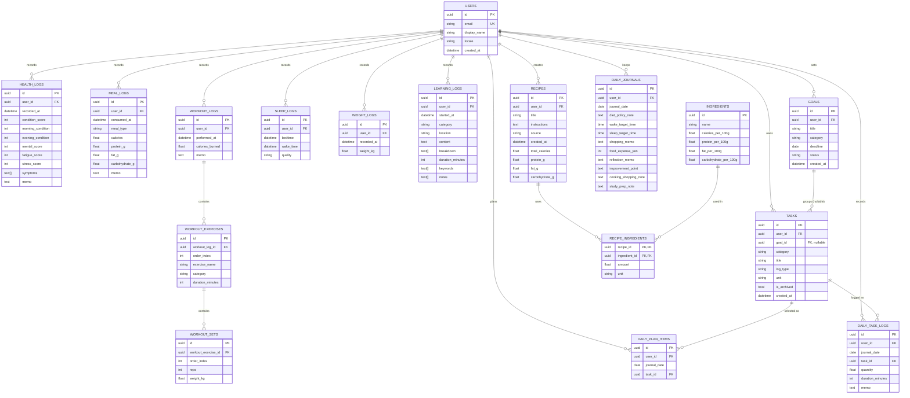

# Database設計

`database/schema.py`のSQLAlchemy ORM Modelに対応するER図。GitHub上で
このファイルを開くと、以下のMermaidコードブロックがそのまま図として
表示される。



## 設計上のポイント

- **`user_id`境界**: `INGREDIENTS`以外の全テーブルが`user_id`を持つ(requirements.md 13章)。`INGREDIENTS`はシステム共通の食材マスタのため`user_id`を持たない。
- **`USERS.locale`**: UI表示言語(`ja`/`en`)をユーザーごとに永続化する。ログイン時にSession Stateへコピーされ、`app/i18n.py`の`t()`がこれを参照して翻訳を切り替える。
- **`WORKOUT_LOGS`の3階層構造**: 1回の運動セッション(`WORKOUT_LOGS`)は複数の種目(`WORKOUT_EXERCISES`)を持ち、筋力トレーニングの種目はさらに複数セット(`WORKOUT_SETS`)を持つ。有酸素運動は`WORKOUT_EXERCISES.duration_minutes`のみを使い、`WORKOUT_SETS`は持たない。
- **`HEALTH_LOGS`の体調5軸化**: 従来の総合`condition_score`(1〜5)に加え、`morning_condition`/`evening_condition`/`mental_score`/`fatigue_score`/`stress_score`(いずれもNullable、1〜5)を持つ。既存データとの互換性のため`condition_score`は「総合スコア」として残し、5軸は追加フィールドとして併存させている。`symptoms`はPostgreSQL配列(`text[]`)としてタグを複数保持する。
- **`LEARNING_LOGS`のカテゴリ依存フィールド**: `category`(試験勉強/PF開発/調べ物/キャリア・プロダクト戦略設計)によって使用するフィールドが異なる(例: 試験勉強は`content`/`breakdown`、キャリア戦略設計は`notes`を使う)。`WORKOUT_LOGS`と同様、全フィールドを同時に埋める必要はない。`breakdown`/`keywords`/`notes`はいずれも`text[]`。
- **`RECIPE_INGREDIENTS`は多対多の中間テーブル**: `RECIPES`と`INGREDIENTS`の間の分量情報(`amount`/`unit`)を保持する。
- **`RECIPES`の栄養情報**: `total_calories`/`protein_g`/`fat_g`/`carbohydrate_g`はAI生成時のみ推定・保存されるnullableな列で、手動登録のレシピでは`NULL`のままとなる。
- **`GOALS`/`TASKS`(長期目標とタスク)**: `GOALS`は長期目標(例: 「Python3エンジニア認定実践試験合格」)、`TASKS`はその配下、または`goal_id`が`NULL`の単発タスクを表す。`TASKS.category`は`GOALS`と同じ区分(学習/PF開発/仕事/食事方針/運動目標/睡眠目標/キャリア・プロダクト戦略/その他生活全般)を持ち、Goal未所属でも分類できる。`TASKS.log_type`が`count_and_duration`のTaskは`DAILY_TASK_LOGS`に数量・時間・メモを記録し、`plan_only`のTaskは選択のみで実績は既存の`MEAL_LOGS`/`WORKOUT_LOGS`/`SLEEP_LOGS`が担う(詳細はrequirements.md 4.4節参照)。
- **`DAILY_PLAN_ITEMS`/`DAILY_TASK_LOGS`**: 「今日」ページのP(計画)・D(実績)に対応する日次テーブル。いずれも`(user_id, journal_date, task_id)`の複合ユニーク制約を持ち、1日1Taskにつき1レコード。
- **`DAILY_JOURNALS`**: 「今日」ページのP/C/A項目(睡眠・食事方針の補足メモ、振り返り、明日変えること)と家計(買い物メモ・食費合計)の入口。`(user_id, journal_date)`の複合ユニーク制約により1ユーザー・1日1レコード。学習・PF開発・仕事はGoal/Task方式に切り出しているため、このテーブルは持たない。

## Migration

スキーマの変更履歴は`database/migrations/versions/`配下のAlembicリビジョンで管理する。初期スキーマは`0001_initial.py`。以降、日時列へのtimezone付与(`0002`)、`recipes`への栄養情報列追加(`0003`)、`learning_logs`テーブル追加(`0004`)、`health_logs`の体調5軸化(`0005`)、`goals`/`tasks`/`daily_plan_items`/`daily_task_logs`/`daily_journals`テーブル追加(`0006`)、未使用列`daily_journals.work_hours`の削除(`0007`)、`users.locale`追加(`0008`)、Google OAuth移行に伴う`user_credentials`テーブル削除(`0009`)などをリビジョンとして積み重ねている。最新リビジョンは`uv run alembic history`で確認できる。

```bash
# 最新スキーマを適用
uv run alembic upgrade head

# 1つ前のリビジョンへ戻す
uv run alembic downgrade -1
```
